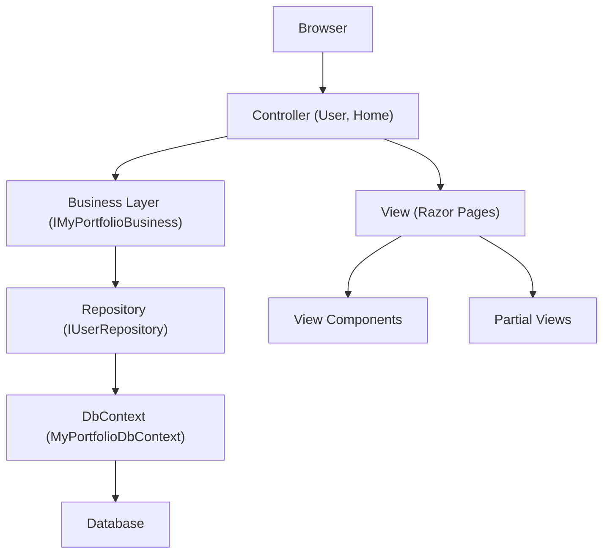

# MyPortfolio.Web

A modern, layered ASP.NET Core (.NET 9) web application for managing user portfolios. The project follows a clean separation of concerns with a focus on maintainability, security, and extensibility.

---

## Table of Contents
- [Project Overview](#project-overview)
- [Project Structure](#project-structure)
- [Architecture Overview](#architecture-overview)
- [Main Design Diagram](#main-design-diagram)
- [Request Processing Flow](#request-processing-flow)
- [UI Event Handling](#ui-event-handling)
- [Layered Design](#layered-design)
- [Frameworks & Technologies](#frameworks--technologies)
- [How to Run](#how-to-run)
- [Extending the Application](#extending-the-application)
- [Security & Best Practices](#security--best-practices)
- [Contributing](#contributing)
- [Additional Resources](#additional-resources)

---

## Project Overview

MyPortfolio.Web is a multi-layered web application for user portfolio management. It demonstrates best practices in ASP.NET Core development, including authentication, modular UI, and clean separation of concerns.

---

## Project Structure

```text
MyPortfolio/
├── MyPortfolio.Web/
│   ├── Controllers/           # MVC Controllers (User, Home, etc.)
│   ├── ViewComponents/        # Custom View Components (MainMenu, UserProfileDropdown)
│   ├── Views/
│   │   ├── Shared/            # Shared layouts, partials, notifications
│   │   ├── User/              # User-related views (login, register, profile)
│   │   └── Home/              # Home and privacy views
│   ├── wwwroot/
│   │   ├── css/               # Custom CSS (e.g., homePageSideBar.css)
│   │   ├── js/                # Custom JS
│   │   └── lib/               # Third-party libraries (Bootstrap, jQuery, Toastr, FontAwesome)
│   └── Program.cs             # Application startup and middleware configuration
│
├── MyPortfolio.Business/
│   ├── Extensions/            # DI registration for business layer
│   ├── Utilities/             # Helpers (e.g., password hashing, notifications)
│   └── MyPortfolioBusiness.cs # Business logic implementation
│
├── MyPortfolio.DataAccess/
│   ├── Context/               # EF Core DbContext and design-time factory
│   ├── EntityModels/          # Database entities (User, etc.)
│   ├── Extensions/            # DI registration for data access layer
│   └── Repositories/          # Repository interfaces and implementations
│
└── MyPortfolio.Models/
    ├── AppModels/             # Core models (BusinessData, ConfigData)
    └── ViewModels/            # View models for UI (Login, Registration, UserProfile)
```
---

## Architecture Overview

- **Presentation Layer (Web):** Handles HTTP requests, user authentication, and rendering Razor views.
- **Business Layer:** Contains business logic, validation, and orchestrates data access.
- **Data Access Layer:** Manages database operations using Entity Framework Core and repository pattern.
- **Models:** Shared contracts for data transfer between layers.

**Key Patterns:**
- Dependency Injection (DI) for all services and repositories.
- Repository pattern for data access.
- ViewModel pattern for UI data binding.
- View Components for reusable UI elements (sidebar, user dropdown).

---

## Main Design Diagram

---

## Request Processing Flow

sequenceDiagram
    participant Browser
    participant Controller
    participant Business
    participant Repository
    participant DbContext

    Browser->>Controller: HTTP Request (e.g., /User/Authenticate)
    Controller->>Business: ValidateUserAccountAsync(loginViewModel)
    Business->>Repository: FindUserByEmailAsync(email)
    Repository->>DbContext: Query Users table
    DbContext-->>Repository: User Entity
    Repository-->>Business: User Entity
    Business-->>Controller: BusinessData (success/failure)
    Controller-->>Browser: Render View / Redirect / Set Cookie

---

## UI Event Handling

- **Server-Side Events:** All form submissions (login, registration, profile update) are handled via HTTP POST to controller actions. Model validation and business logic are executed server-side.
- **Client-Side Events:** Toastr notifications are triggered via TempData in controllers and rendered in the `_Notification.cshtml` partial using JavaScript.
- **Navigation:** Sidebar and user dropdown are implemented as View Components for modularity and reusability.

---

## Layered Design

- **Web Layer:** Handles routing, authentication (cookie-based), and view rendering.
- **Business Layer:** Implements core logic, validation, and orchestrates repository calls.
- **Data Access Layer:** Uses EF Core DbContext and repositories for CRUD operations.
- **Models:** Strongly-typed ViewModels and AppModels for data transfer.

---

## Frameworks & Technologies

- **.NET 9 / C# 13**
- **ASP.NET Core MVC (Razor Pages)**
- **Entity Framework Core** (SQL Server)
- **Bootstrap 5** (UI styling)
- **Toastr** (notifications)
- **FontAwesome** (icons)
- **jQuery** (client-side scripting)
- **Dependency Injection** (built-in)
- **Cookie Authentication**

---

## How to Run

1. **Clone the repository:**
   git clone https://github.com/Kiran9684/MyPortfolio.git

2. **Configure the database:**
- Update the connection string in `appsettings.json` under `MyPortfolioDBConfig:ConnectionString`.

3. **Apply migrations:**
   dotnet ef database update --project MyPortfolio.DataAccess

4. **Run the application:**
   dotnet run --project MyPortfolio.Web

5. **Access the app:**
- Open `https://localhost:5001` in your browser.

---

## Extending the Application

- **Add new features:** Implement new controllers, views, or view components as needed.
- **Business logic:** Add methods to `IMyPortfolioBusiness` and implement in `MyPortfolioBusiness`.
- **Data access:** Add new repositories or extend existing ones in the DataAccess layer.
- **UI:** Use Razor Pages and View Components for modular, reusable UI.

---

## Security & Best Practices

- **Authentication:** Cookie-based, with login and access denied redirection.
- **Password Storage:** Secure hashing and salting.
- **Configuration:** Sensitive data (like connection strings) should be moved to secure storage (e.g., Azure Key Vault) for production.
- **Validation:** All user input is validated via DataAnnotations and server-side checks.

---

## Contributing

Contributions are welcome! Please follow these guidelines:
- Ensure code style matches the project conventions.
- Write clear commit messages.
- Add/Update documentation as needed.
- Submit pull requests for review.

---

## Additional Resources

For local setup instructions, see the [Installation Guide](docs/local-setup.md).

For Technical flow documents, see the [Technical Flows Guide](docs/technical-flows.md).

For cheat sheet 👉 [click-here](docs/cheatsheet.md)

For further details, refer to the codebase and comments in each layer. Contributions and improvements are welcome!
