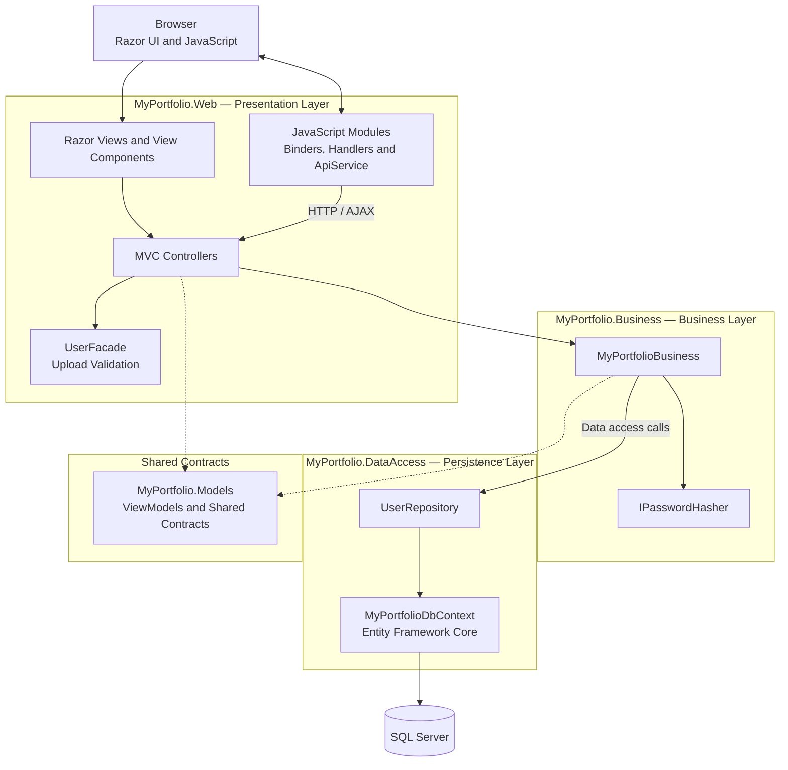
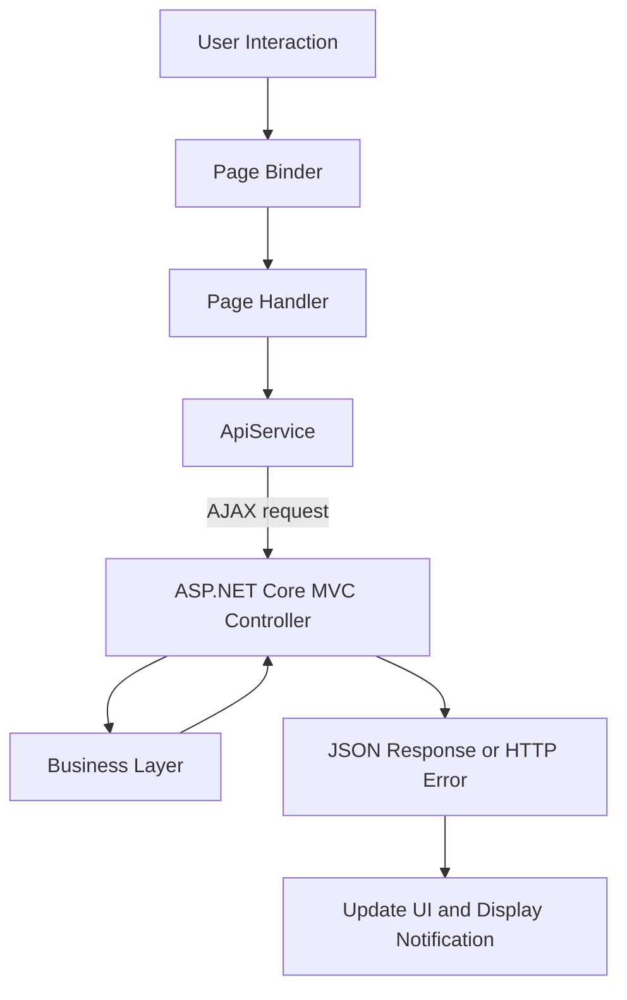

# MyPortfolio

**MyPortfolio** is a full-stack web application built with ASP.NET Core MVC, C#, Entity Framework Core, and SQL Server. It provides user registration, authentication, and profile creation and management, with the goal of evolving into a tool for creating professional profiles using customizable templates and supporting export and sharing options in the future.

The project is designed around a layered (N-tier) architecture, with separate Web, Business, Data Access, and Models projects. It also demonstrates modular JavaScript, asynchronous database operations, server-side validation, cookie-based authentication, and structured logging.

> **Project status:** Active development  
> **Framework:** .NET 9  
> **Database:** SQL Server

## Table of Contents

- [Overview](#overview)
- [Key Features](#key-features)
- [Technology Stack](#technology-stack)
- [Architecture](#architecture)
- [Request Processing](#request-processing)
- [Frontend Architecture](#frontend-architecture)
- [Profile Picture Workflow](#profile-picture-workflow)
- [Security and Validation](#security-and-validation)
- [Project Structure](#project-structure)
- [Getting Started](#getting-started)
- [Testing](#testing)
- [Current Scope and Future Improvements](#current-scope-and-future-improvements)
- [License](#license)

## Overview

MyPortfolio is a hands-on software engineering project focused on building a maintainable web application with a clear separation of responsibilities.

The application follows a layered (N-tier) architecture, separating HTTP request handling, business logic, data access, and shared models across dedicated projects.

The current implementation focuses on user account management and profile creation and management. It combines server-rendered Razor views with JavaScript-driven AJAX interactions, providing a foundation for future enhancements such as customizable profile templates, PDF export, and email sharing.

## Key Features

### User Accounts and Authentication

- User registration with input validation.
- Login with credential verification.
- Password hashing and salt-based password storage.
- Account-active status checks during authentication.
- Cookie-based authentication using claims.
- Authorization of protected controller actions.
- Logout and authentication redirection.

### User Profile Management

- Retrieve and update the authenticated user's profile information, including personal and address details.
- Profile-picture upload and retrieval with JPEG and PNG format validation.
- Server-side validation of file extensions, file sizes, and file signatures.
- Browser-based image preview before upload.
- Store profile-picture data and MIME type in SQL Server.
- Associate profile-picture retrieval with the authenticated user's identity.
- MVC model validation and application notifications for success and error feedback.

### Frontend Interaction

- Page-specific JavaScript modules for event binding and event handling.
- A reusable AJAX service for GET and POST requests.
- `FormData` support for multipart file uploads.
- Shared utilities for global loading indicators.
- Toastr notifications for user feedback.
- Bootstrap-based responsive UI components and reusable Razor View Components.

### Application Infrastructure

- Dependency injection for application services.
- Repository-based database access using Entity Framework Core.
- Asynchronous database operations.
- Serilog application and HTTP request logging.
- Configuration-driven database connection and profile-picture settings.

### Planned Enhancements

- Create professional portfolios using customizable templates.
- Export completed portfolios to PDF.
- Share portfolios through email.
- Extend profile customization and presentation options.

## Technology Stack

| Area | Technologies |
|---|---|
| Backend | C#, ASP.NET Core MVC, .NET 9 |
| Data access | Entity Framework Core 9, Repository Pattern |
| Database | Microsoft SQL Server |
| Frontend | Razor Views, HTML, CSS, JavaScript |
| JavaScript | ES Modules, jQuery, AJAX |
| UI framework | Bootstrap 5 |
| Notifications | Toastr |
| Logging | Serilog |
| Authentication | ASP.NET Core Cookie Authentication |
| Configuration and DI | `appsettings.json`, ASP.NET Core Dependency Injection |
| Development | Visual Studio, .NET CLI, NuGet, Git |

## Architecture

MyPortfolio follows a layered N-tier architecture. Each project has a distinct responsibility, helping keep HTTP concerns, business operations, and persistence logic separate.

### High-level architecture


- [**Request Processing**](docs/request-processing.md): Sequence diagrams illustrating registration, authentication, profile management, and profile-picture workflows.


### Project responsibilities

| Project | Responsibility |
|---|---|
| `MyPortfolio.Web` | MVC controllers, Razor views, View Components, frontend assets, request validation, and HTTP responses. |
| `MyPortfolio.Business` | Account validation, registration, profile operations, password verification, and coordination of data access. |
| `MyPortfolio.DataAccess` | EF Core DbContext, entity models, repositories, database queries, persistence, and migrations. |
| `MyPortfolio.Models` | ViewModels, validation results, shared application models, and response contracts. |
| `UnitTests` | Automated tests for selected application behavior. |

The application uses dependency injection to provide services and repositories to the components that need them. The Business layer uses repository abstractions to access persisted data.


## Frontend Architecture

The frontend combines Razor-rendered pages with modular JavaScript. Page-specific event binding is separated from event handling, while common HTTP and UI utilities are shared across pages.

### JavaScript module structure

```text
wwwroot/js/
├── pages/
│   ├── MainMenu/
│   │   ├── MainMenu.js
│   │   ├── MainMenuBinders.js
│   │   └── MainMenuHandler.js
│   ├── RegisterUser/
│   │   ├── RegisterUser.js
│   │   ├── RegisterUserBinder.js
│   │   └── RegisterUserHandler.js
│   └── UserProfile/
│       ├── UserProfile.js
│       ├── UserProfileBinders.js
│       └── UserProfileHandler.js
├── services/
│   ├── ApiService.js
│   └── AppUtilities.js
└── site.js
```

### Responsibilities of the frontend modules

- **Page entry modules:** Initialize the relevant page modules when the document is ready.
- **Binders:** Attach DOM events to their corresponding handlers.
- **Handlers:** Process user interactions and coordinate UI behavior.
- **`ApiService`:** Centralize AJAX GET and POST requests, including JSON requests and `FormData` uploads.
- **`AppUtilities`:** Provide shared UI utilities, including the global loading spinner.

### UI-to-backend interaction



AJAX is used for selected interactions, such as profile-picture uploads. Standard MVC form submissions and redirects are used for other workflows, including the profile update flow.

## Security and Validation

Security-related implementation details include:

- **Cookie authentication:** ASP.NET Core Cookie Authentication establishes the authenticated user's identity.
- **Claims:** The authentication cookie contains name, email, and name-identifier claims.
- **Authorization:** Protected controller actions use `[Authorize]`.
- **Password handling:** Password verification is delegated to `IPasswordHasher`; registration stores the resulting password hash and salt rather than the plaintext password.
- **Model validation:** MVC model validation is checked before account and profile operations.
- **File validation:** The server checks permitted extensions, file size, and file-signature bytes for profile-picture uploads.
- **User-scoped image retrieval:** The image lookup uses both the authenticated user's ID and the public image identifier.
- **Logging:** Serilog and application-level log statements provide visibility into requests and selected operations.
- **Configuration:** The database connection string and profile-picture settings are read from application configuration.

These controls form part of the current implementation. They should not be interpreted as a complete security audit or a claim of production readiness.

## Project Structure

```text
MyPortfolio/
├── MyPortfolio.Web/
│   ├── Controllers/
│   ├── Facades/
│   ├── ViewComponents/
│   ├── Views/
│   ├── wwwroot/
│   │   ├── css/
│   │   ├── js/
│   │   └── lib/
│   ├── Program.cs
│   └── appsettings.json
│
├── MyPortfolio.Business/
│   ├── Extensions/
│   ├── Utilities/
│   ├── MyPortfolioBusiness.cs
│   └── IMyPortfolioBusiness.cs
│
├── MyPortfolio.DataAccess/
│   ├── Context/
│   ├── EntityModels/
│   ├── EntityConfigs/
│   ├── Repositories/
│   └── Migrations/
│
├── MyPortfolio.Models/
│   ├── ViewModels/
│   ├── AppModels/
│   └── Common/
│
└── UnitTests/
```

This is a representative structure based on the project layout shared so far. Individual filenames and test organization may evolve during development.

## Getting Started

### Prerequisites

- .NET 9 SDK
- Microsoft SQL Server
- Visual Studio 2022 with compatible .NET 9 tooling, or Visual Studio Code
- Git
- Entity Framework Core CLI tools for database migrations

### 1. Clone the repository

```bash
git clone https://github.com/Kiran9684/MyPortfolio.git
cd MyPortfolio
```

### 2. Configure the database

Open `MyPortfolio.Web/appsettings.json` and configure the connection string under `MyPortfolioDBConfig:ConnectionString`.

For example, a local SQL Server development connection might look like:

```json
{
  "MyPortfolioDBConfig": {
    "ConnectionString": "Server=YOUR_SERVER;Database=MyPortfolio;Trusted_Connection=True;TrustServerCertificate=True"
  }
}
```

Use the actual configuration structure already present in the project, and replace the example connection details with your local SQL Server settings.

Also review the `ProfilePictureSettings` section to confirm the permitted file extensions and maximum upload size.

**Security note:** Do not commit real credentials, production connection strings, or other secrets to source control. Use an appropriate local configuration or secret-management mechanism.

### 3. Restore dependencies

From the repository root, assuming the solution file is located there:

```bash
dotnet restore
```

### 4. Apply database migrations

Ensure the EF Core CLI tools are available. If necessary, install them using:

```bash
dotnet tool install --global dotnet-ef
```

From the repository root, apply the migrations using the DataAccess project for migrations and the Web project as the startup project:

```bash
dotnet ef database update --project MyPortfolio.DataAccess --startup-project MyPortfolio.Web
```

If the project files use different paths or the solution has a different startup configuration, adjust the command accordingly.

### 5. Run the application

```bash
dotnet run --project MyPortfolio.Web
```

Open the HTTPS URL reported by the application in the terminal. The default MVC route points to the User controller's Index action, which displays the login page.

## Testing

The repository contains a `UnitTests` project and some automated tests. Test coverage has not yet been assessed, so this README does not claim comprehensive coverage.

To build the solution and run the tests, use the solution file or test project path that exists in the repository:

```bash
dotnet build
dotnet test
```

Further testing can focus on account validation, profile updates, authorization, file-upload validation, and image retrieval behavior.

## Current Scope and Future Improvements

MyPortfolio is actively being developed as a personal software engineering project to explore .NET technologies, apply software design principles, and build a foundation for professional portfolio creation.

The current implementation focuses on user registration, authentication, and profile creation and management.

Potential future enhancements include:

- **Portfolio Creation:** Create professional portfolios using customizable templates.
- **PDF Export:** Export completed portfolios as PDF documents.
- **Email Sharing:** Enable users to share their portfolios through email.
- **Automated Testing:** Expand unit and integration test coverage.
- **Security and Validation:** Review authentication settings, production configuration, and input and file validation.
- **Application Reliability:** Improve error handling, logging, and operational diagnostics.
- **Architecture Refinement:** Continue improving shared validation, response contracts, and separation of responsibilities.

These enhancements represent potential future work and are not claims of existing functionality.

## License

No license has been confirmed for this repository yet.
