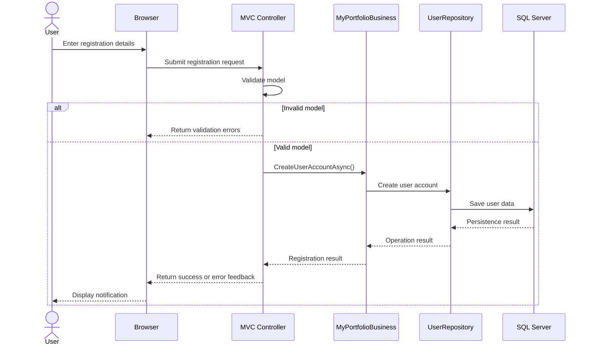
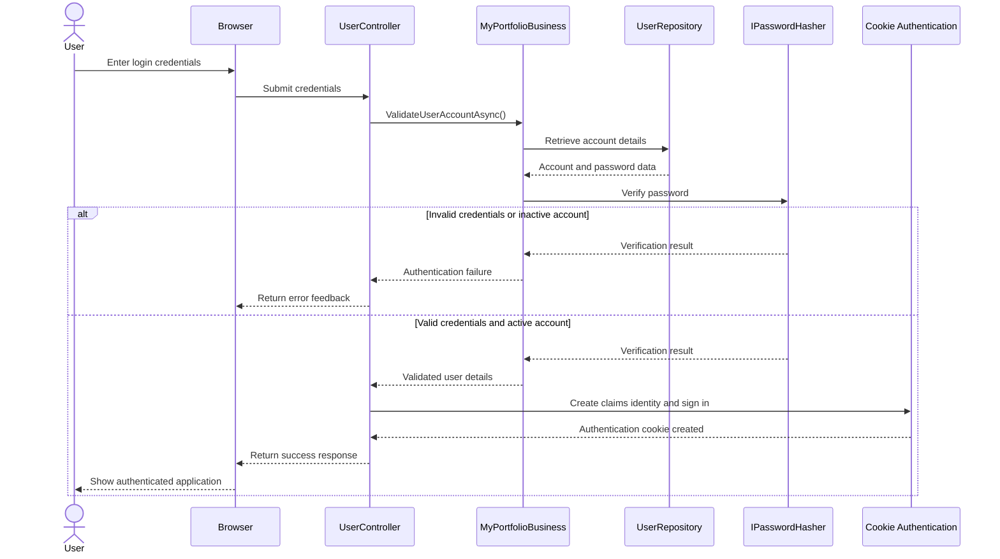
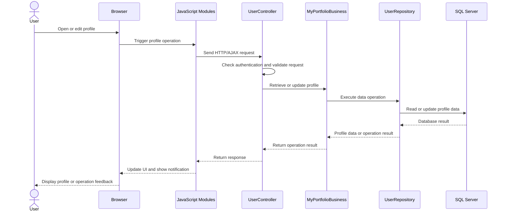
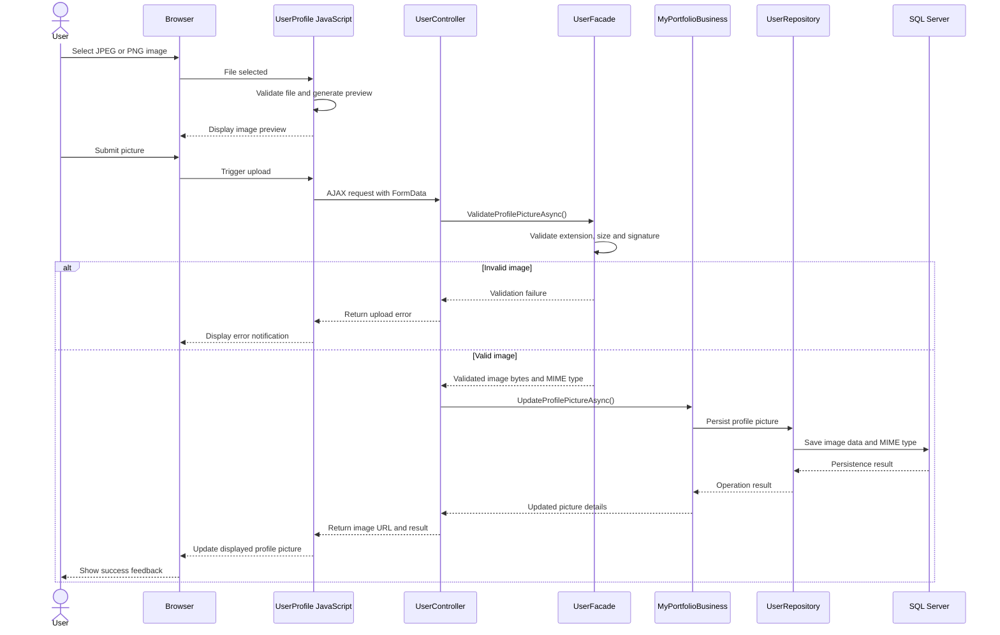
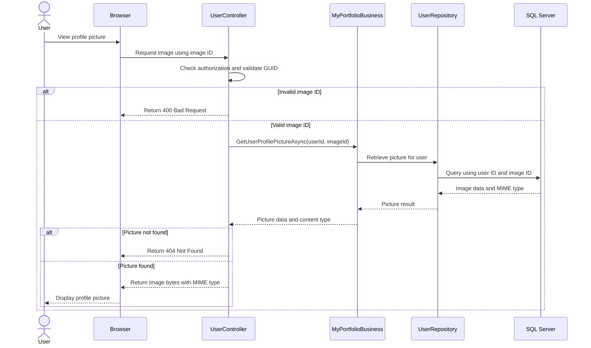
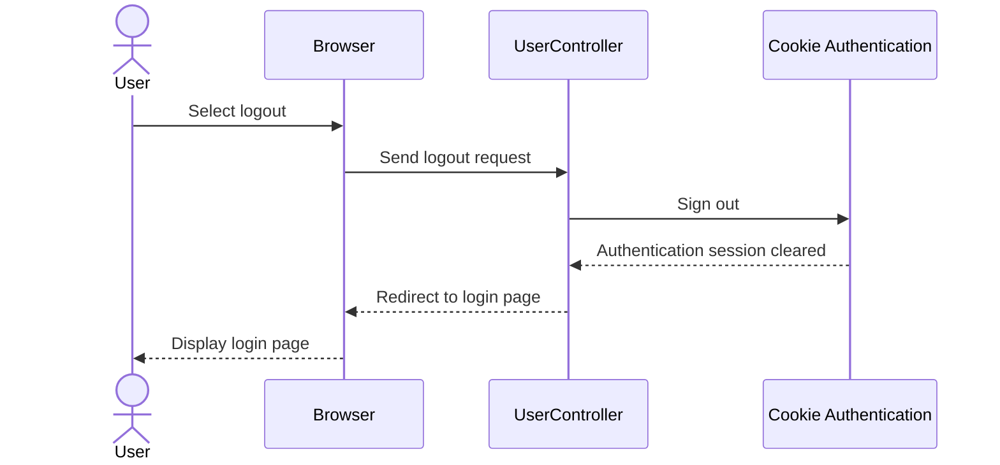

# Request Processing

This document describes how requests flow through MyPortfolio, from user interactions in the browser to the application layers and database.

It uses Mermaid sequence diagrams to illustrate the interactions between the presentation layer, business layer, data access layer, shared models, and SQL Server.

## Table of Contents

- [1. User Registration](#1-user-registration)
- [2. User Login](#2-user-login)
- [3. User Profile Management](#3-user-profile-management)
- [4. Profile Picture Upload](#4-profile-picture-upload)
- [5. Profile Picture Retrieval](#5-profile-picture-retrieval)
- [6. User Logout](#6-user-logout)

---

## 1. User Registration

Illustrates the registration flow, including form submission, server-side validation, business-layer processing, and persistence.

## 2. User Login

Illustrates credential verification and the creation of an authentication cookie after successful authentication.

## 3. User Profile Management

Illustrates retrieving and updating the authenticated user's profile information.

## 4. Profile Picture Upload

Illustrates the profile-picture upload workflow, including browser-side preview, AJAX submission, server-side validation, and database persistence.

## 5. Profile Picture Retrieval

Illustrates retrieving a stored profile picture through an authorized endpoint. The image identifier is validated, and the authenticated user's identity is used when requesting the image.

## 6. User Logout

Illustrates signing out the authenticated user by clearing the application authentication session.

---

## Notes

- The diagrams describe the intended request flow based on the current application design; implementation details may vary by controller action.
- The Web layer handles HTTP requests and responses, while business operations and persistence are delegated to their respective layers.
- `MyPortfolio.Models` contains shared view models and contracts used for communication between application components; it is not a separate runtime processing stage.
- Profile-picture upload and retrieval are documented here as feature-specific request flows rather than separate top-level architecture layers.
- As new features are implemented, add their sequence diagrams to this document and include a corresponding entry in the table of contents.
